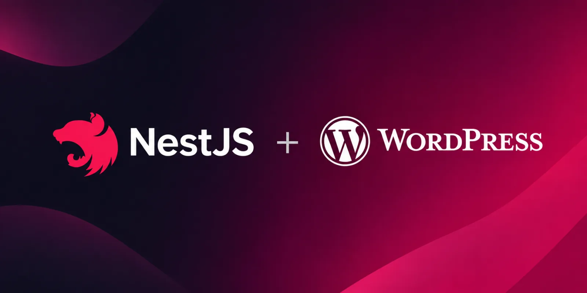

**WordPress as a headless CMS for NestJS.**

Normalized content, tag-based caching and signed webhooks. Let editors work in WordPress while your NestJS API serves typed content to every client.

[](https://github.com/crashncrow/nestjs-wordpress/actions/workflows/ci.yml)
[](LICENSE)

[Guide](packages/nestjs-wordpress/README.md) · [NestJS demo](apps/demo) · [Next.js demo](apps/web) · [WordPress plugin](wordpress-plugin) · [Docs](docs)

> **Pre-release:** nestjs-wordpress is not on npm yet. APIs may still change before `1.0`.

```
WordPress ──(REST)──▶ NestJS + nestjs-wordpress ──(JSON)──▶ web / mobile / Next.js
    │                       ▲  normalized DTOs, tag cache        ▲
    └── plugin: signed webhook ┘ ── wordpress.content.updated ───┘ revalidateTag
```

## Repository layout

| Path                                                     | What                                                                                                   |
| -------------------------------------------------------- | ------------------------------------------------------------------------------------------------------ |
| [`packages/nestjs-wordpress`](packages/nestjs-wordpress) | The library published to npm                                                                           |
| [`apps/demo`](apps/demo)                                 | NestJS app using the library: posts, pages, menus, a BFF `/home` aggregate, a Redis cache and webhooks |
| [`apps/web`](apps/web)                                   | Next.js frontend consuming the demo, revalidated by tag when WordPress changes                         |
| [`wordpress-plugin`](wordpress-plugin)                   | PHP plugin that sends HMAC-signed change webhooks                                                      |
| [`docker`](docker)                                       | WordPress, MySQL and Redis stack, plus an idempotent WP-CLI seed                                       |
| [`docs`](docs)                                           | Research and implementation plan                                                                       |

## Quick start

**Requirements**

- Node.js ≥ 22.12
- pnpm 12 (run `corepack enable` once to use the version pinned in `package.json`)
- Docker, running

> **macOS:** if the repository lives outside `/Users` (e.g. on another volume), add its folder in Docker Desktop → Settings → Resources → File sharing. Otherwise the WordPress plugin cannot be mounted.

```bash
pnpm install
pnpm wp:up && pnpm wp:seed   # WordPress at http://localhost:8080 (admin / admin)
```

Then, in two terminals:

```bash
pnpm dev       # terminal 1: NestJS demo at http://localhost:3000 (try /home, /posts, /menus/primary)
pnpm dev:web   # terminal 2: Next.js at http://localhost:3001 (needs the NestJS demo running)
```

Edit a post's title in WordPress and reload: the change propagates through the webhook, the NestJS cache and the Next.js cache.

**Good to know**

- WordPress sends webhooks to `http://host.docker.internal:3000`, so keep the NestJS demo on port 3000.
- `pnpm wp:seed` is idempotent, but it rotates the demo's application password. Restart `pnpm dev` and `pnpm dev:web` after re-seeding.
- `pnpm wp:down` stops the stack and keeps the data. To start from scratch, run `bash docker/compose.sh down -v`.

## Contributing

Bugs and ideas: [issues](https://github.com/crashncrow/nestjs-wordpress/issues). Setup, commands and the rules for code changes: [CONTRIBUTING.md](CONTRIBUTING.md). Security problems: report them privately, see [SECURITY.md](SECURITY.md).

## License

This project is licensed under the [MIT License](LICENSE).

---

<p align="center">
  <sub>Made with 🧉 by <a href="https://nnaro.dev">nnaro.dev</a></sub>
</p>
